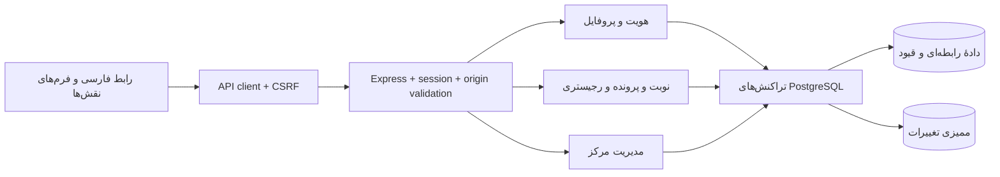

# معماری شمساز

## تصمیم معماری

ساختار فعلی یک برنامهٔ ماژولار واحد است: React برای ارائه، Express برای اجرای قواعد و PostgreSQL برای دادهٔ پایدار. تفکیک حوزه‌ها در پوشه‌ها انجام می‌شود تا افزودن خدمت جدید بدون تبدیل اولیهٔ پروژه به چند سرویس مستقل ممکن باشد.

## مرز مسئولیت‌ها

| لایه | مسئولیت | قاعده |
|---|---|---|
| `src/features` | نمایش و دریافت ورودی حوزه | ذخیرهٔ موفق تنها پس از پاسخ API |
| `src/shared/api` | انتقال قرارداد، خطا و CSRF | cookie با credentials؛ رد پاسخ غیر JSON |
| `shared/contracts.ts` | انواع مشترک | هیچ secret یا dependency سرور در فرانت وارد نمی‌شود |
| `server/modules` | اعتبارسنجی، مجوز و گردش‌کار | نقش و مالکیت از نشست سرور |
| `server/db` | pool، تراکنش و migration | SQL پارامتری، rollback هنگام خطا |
| `database/postgres/migrations` | ساختار و قیود | migration اجراشده بازنویسی نمی‌شود |

اجزای قدیمی در featureهای مربوط حفظ شده‌اند تا تاریخچهٔ محصول از بین نرود؛ داشبورد عملیاتی جدید از `features/dashboard` ارائه می‌شود. نمونهٔ تحلیل بقا و نسخه‌نویسی نمایشی قبلی در مسیر عملیاتی فعال نیستند.

## مدل دسترسی

- بیمار فقط اطلاعات و درخواست‌های خودش را می‌خواند و تغییر می‌دهد.
- پزشک اطلاعات بیماران تحت مراقبت و پیش‌نویس‌های بالینی خودش را ثبت می‌کند.
- کارشناس رجیستری پرونده‌های مرکز خودش را ثبت و بررسی می‌کند.
- مدیر مرکز تنظیمات، کارکنان، زمان‌های پزشک و پذیرش بیمار مرکز خودش را مدیریت می‌کند.
- ناظر ملی آمار تجمیعی می‌بیند و به فهرست هویتی پرونده‌ها دسترسی نمی‌گیرد.

مدل فعلی یک مرکز اصلی برای هر حساب دارد. ساختار membership برای توسعهٔ بعدی وجود دارد؛ مجوز چندمرکزی و انتقال پرونده هنوز گردش‌کار مستقل می‌خواهد. نقش مدیر مرکز و ناظر از ثبت‌نام عمومی ایجاد نمی‌شود.

پذیرش مرکز فعلاً بر تأیید کارمند دربارهٔ دریافت رضایت تکیه دارد؛ تأیید مستقیم بیمار، سند امضاشده و کنترل بیرونی مجوز پزشک هنوز پیاده‌سازی نشده‌اند. نمایش شماره نظام پزشکی به معنای استعلام رسمی آن نیست.

## چرخهٔ ثبت داده

فرم، داده را در حافظهٔ رابط نگه می‌دارد. هنگام ثبت، API مقدار، نقش و مالکیت را کنترل می‌کند. رکورد اصلی و رخداد ممیزی در یک تراکنش ذخیره می‌شوند. سپس دادهٔ تازه به رابط برمی‌گردد؛ refresh یا خروج از حساب باعث حذف رکورد ثبت‌شده نمی‌شود.

رزرو فقط برای اسلات معتبر پزشک انجام می‌شود. قیود exclusion و unique در PostgreSQL جلوی رقابت درخواست‌های هم‌زمان را می‌گیرند. تغییر وضعیت نوبت با قفل رکورد و کنترل انتقال وضعیت انجام می‌شود.

تاریخ‌های ذخیره‌شده استاندارد ISO/TIMESTAMPTZ و تاریخ تولد DATE هستند. نمایش فارسی در رابط انجام می‌شود. منطقهٔ زمانی نمایش خدمات ایران است؛ تبدیل تقویم شمسی با تغییر سال یا ماه ثابت انجام نمی‌شود.

## محیط اجرا

محیط توسعه یک process برای Express و middleware Vite دارد. محیط production فایل‌های ساخته‌شده را با Express ارائه می‌کند. PostgreSQL مستقل از process برنامه در volume Docker محلی نگهداری می‌شود. `.env`، کش و دادهٔ محلی در Git قرار نمی‌گیرند.

## معیارهای کنترل کیفیت

1. TypeScript سخت‌گیرانه و build بدون خطا.
2. تست واقعی PostgreSQL برای روابط، رزرو هم‌زمان، کدهای ساختاری و ممیزی.
3. تست API برای نشست، CSRF، تفکیک نقش و ثبت پایدار.
4. بررسی مرورگر برای ورود، فرم‌ها، refresh و عرض‌های مختلف هدر.

## حدود آمادگی عملیاتی

این معماری زیرساخت توسعهٔ محصول است. قبل از استفاده با اطلاعات واقعی باید نقش دیتابیس با حداقل مجوز، TLS، چرخهٔ رمز و بازیابی حساب، سیاست رضایت و نگهداری، مدیریت فایل امن، مانیتورینگ و فرایند تأیید بالینی اضافه شوند. دستورالعمل ثبت در فرم یا وجود قید SQL، اعتبار پزشکی محتوای ثبت‌شده را تأیید نمی‌کند.
