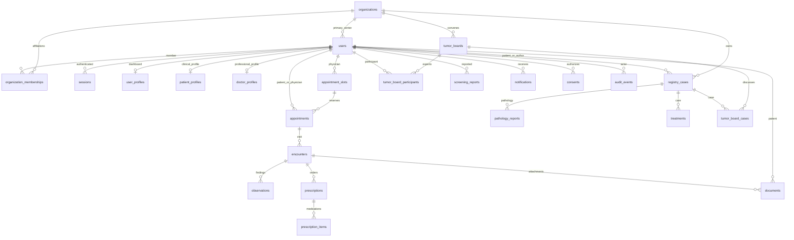

# Shamsaz relational database

PostgreSQL 17 is the canonical, operational database. `database/postgres/migrations` contains immutable ordered migrations; `server/db/index.ts` manages the connection pool and transactions. Node.js reads `DATABASE_URL` from the local environment. No credentials are stored in migrations.

Run `npm run db:migrate` to migrate; run `npm test` for integration verification in an isolated temporary local database. Migrations acquire a PostgreSQL advisory lock, verify SHA-256 checksums, and execute atomically. Change an applied schema through a new migration, never by rewriting an existing migration.

## Data model

| Domain | Tables | Ownership |
|---|---|---|
| Identity | users, sessions, organization_memberships | Server assigns patient, doctor, registry_clerk, clinic_admin, national_supervisor roles |
| Organization | organizations | Centers and membership boundaries |
| Profiles | user_profiles, patient_profiles, doctor_profiles | Generic dashboard payload plus normalized clinical fields |
| Scheduling | appointment_slots, appointments | Patient, doctor, center, reservable slot |
| Clinical record | encounters, observations, documents | Patient, author, visit |
| Cancer registry | registry_cases, pathology_reports, treatments | Organization, registering user, patient |
| Prescribing | prescriptions, prescription_items | Prescriber and patient |
| Multidisciplinary care | tumor_boards, tumor_board_cases, tumor_board_participants | Organization and registry case |
| Patient interaction | screening_reports, notifications, consents | Patient/user and policy version |
| Accountability | audit_events, schema_migrations | Immutable audit events and migration ledger |

All domain identifiers are TEXT to support generated UUIDs and explicit synthetic demo identifiers. Timestamps are native `TIMESTAMPTZ`, calendar birth dates are `DATE`, and extensible payloads are `JSONB`. Frontend dates must be ISO timestamps; Persian calendar formatting is presentation only. Foreign keys prevent orphan records. Status checks prevent invalid states. Partial unique indexes prevent two active appointments from reserving the same slot or physician start time. PostgreSQL `btree_gist` exclusion constraints also prevent overlapping active physician appointments, including simultaneous requests. APIs must supply finite end times. Screening reports default to `unassessed`; storing a report does not constitute clinical triage.

Use parameterized statements for values, `transaction(async client => ...)` for multi-record operations, and organization/user authorization before reading or changing data. PostgreSQL constraints provide integrity; they do not replace access controls. Audit events reject update/delete at the database layer. The application database account must have least privilege in production; a database owner can disable triggers, so this is not a tamper-proof external ledger.

Composite foreign keys require a registry patient and author to belong to the record's organization, and slot/appointment doctors to belong to the selected organization. Current workflows use one primary center (`users.organization_id`); `organization_memberships` prepares for additional affiliations, but multi-center clinical authorization is not implemented yet. A patient's self-registration does not assign a center. Onboarding or verified enrollment must establish that relationship before center registry access. The synthetic demo patient is explicitly enrolled in the synthetic center.

Encounters have separate `subjective`, `objective`, `assessment` and `plan` SOAP fields; `chief_complaint` remains a concise independent field. Registry records include separate ICD-10, ICD-O morphology/behavior, staging system/version, TNM components and grade. Format constraints are data-entry guards only: they do not prove that a code exists in an official vocabulary or that the selected stage is clinically correct. Current TNM format supports common T/N/M components with optional c/p/yc/yp/r/a prefixes and a–c suffixes, not every specialty-specific notation. An official versioned vocabulary service and specialist approval are required before comprehensive coded clinical use. Appointment slot intervals, including blocked slots, cannot overlap for the same doctor.

Tumor board creators belong to the board's center. Database triggers require linked registry cases to share that center and participants to be doctors from that center. Populated boards and linked registry cases cannot change center. Visiting external experts and inter-center board transfers require a separately designed authorization workflow; they are not supported by the current constraints.



## Explicit local demonstration

`ENABLE_DEMO_SEED=true` and a `DEMO_PASSWORD` of at least 12 characters opt into synthetic accounts and one visibly marked synthetic clinic. Seeding is blocked in production and idempotent; it never creates real patient records. Login emails: `patient@shamsaz.local`, `doctor@shamsaz.local`, `registry@shamsaz.local`, `admin@shamsaz.local`, `supervisor@shamsaz.local`. Password is set in the local environment and hashed with salted scrypt. Existing account passwords are not silently reset. Four slots per day are supplied over the next fourteen days. No clinical outcomes, prediction metrics or prescriptions are seeded.

## Operational boundary

Schema support does not mean every domain has a completed API or user workflow. The implemented services include profiles, appointments, self-reported symptoms, registry, pathology, physician treatment records, draft encounters/prescriptions, center administration and recorded tumor-board decisions. Document upload, observation entry, notifications and external media/insurance services still need application workflows. Production deployment additionally needs separate least-privilege application/migration roles, encrypted transport, backups with restore exercises, monitoring, retention policies and clinical governance. Database credentials must remain outside version control.

## Backup and restore

Use PostgreSQL client tools matching server major version. These PowerShell commands assume environment variables are already securely loaded. Keep backups outside public web directories and encrypt them using your approved storage system. Do not place real credentials in command history.

```powershell
pg_dump --dbname=$env:DATABASE_URL --format=custom --file=shamsaz.backup
pg_restore --dbname=$env:RESTORE_DATABASE_URL --no-owner --exit-on-error shamsaz.backup
```

Restore into a new empty, isolated database. Compare row counts and migrations, run FK/schema checks, and exercise login, booking and registry retrieval before promoting a restored environment. Physical/WAL backups and point-in-time recovery are not configured by the development Docker setup. Define backup frequency, recovery point and recovery time with the deployment owner and test restoration routinely.

## Retention and privacy boundaries

Expired sessions are rejected in authentication queries; expiry does not delete their rows. Schedule a parameterized `DELETE FROM sessions WHERE expires_at < CURRENT_TIMESTAMP` maintenance task after choosing the required security retention. Clinical records and audit entries have no automatic purge. Consent revocation is recorded via `revoked_at`; it does not retroactively remove records or enforce research exports. An approved purpose-specific retention and deletion workflow is still required. FK restrictions intentionally prevent cascading deletion of clinical history. National identifiers, clinical JSON and documents are not encrypted at the column layer. No compliance or clinical validation is inferred from the schema.

Database constraint tests run within a rollback-only fixture transaction and cover case-insensitive email uniqueness, roles, JSON validity, session expiry, organization boundaries, positive prescription duration, reservation conflicts and audit immutability. API tests create synthetic records. The standard `npm test` runner creates an isolated temporary database and drops only that generated database afterward; an explicit `TEST_DATABASE_URL` is retained. Direct test-file execution bypasses isolation and should never target production.
